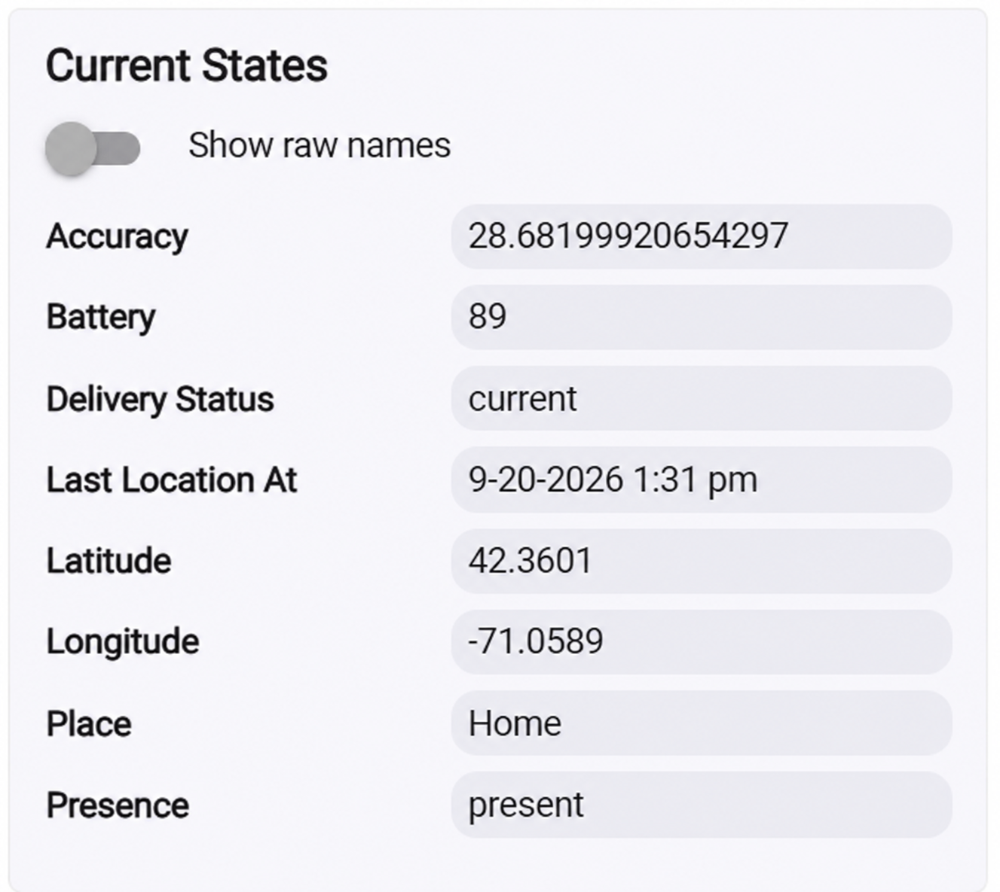

> [!WARNING]
> **The old Home Assistant app has been retired and its executable app code removed.**
> Install and update Pixora Locator from **[PixoraHQforHA](https://github.com/bptworld/PixoraHQforHA)**.
> [Current Locator app and instructions](https://github.com/bptworld/PixoraHQforHA/tree/main/pixora_locator).
>
> Removing this repository code does not transfer or delete an installed app or its data.
> Back up your old installation and preserve its phone registrations before switching.
> Keep the old app stopped after verifying the replacement. Do not run both together.

# PixoraLocator

Hubitat and HomeSeer integrations remain here. The Home Assistant app is maintained in PixoraHQforHA. The phone APK is distributed separately.

## Hubitat

Each phone can update its own Pixora Locator virtual device with the latest location, saved Place, presence, accuracy, battery, and human-readable report time.

_Screenshot uses fictional coordinates._

1. In Planner, connect Hubitat under **Setup Options → Hubitat** using the Maker API Cloud URL, App ID, and access token.
2. In Hubitat, open **Drivers Code** and choose **New Driver**.
3. Paste the contents of [`hubitat/PixoraLocator.groovy`](hubitat/PixoraLocator.groovy) and save it.
4. Open **Devices**, choose **Add Device → Virtual**, and select **Pixora Locator** as the device type, then enable it in Maker API.
5. In the Pixora Locator phone app, enable Hubitat under **Settings → Where to send** and select the virtual device.

The Hubitat driver source and detailed instructions are in [`hubitat/`](hubitat/).

### One-time OwnTracks Place migration

Install the separate [`Pixora Locator OwnTracks Importer`](hubitat/PixoraLocatorOwnTracksImporter.groovy) Hubitat app to receive an OwnTracks region list through OwnTracks' existing Secondary Hub transfer. The importer is armed manually, accepts only a waypoint list, rejects live locations, and automatically deletes its temporary Place definitions after one hour. It creates a checksummed `.pixora` file containing only selected Place names, center points, radii, and stable OwnTracks waypoint IDs.

Locator imports up to 50 selected OwnTracks Places into a household with a maximum of 75 Places. It imports no location history, arrival/departure activity, alert settings, members, credentials, or continuing synchronization. OwnTracks itself is not changed.

## HomeSeer HS4

The HomeSeer plugin creates one device for each sharing phone in the paired Locator household. Each device exposes the phone's current latitude, longitude, GPS accuracy, saved Place, presence at a saved Place, battery, movement, sharing mode, report time, and since time. It never requests or stores a route or location history.

1. Install the plugin files in the HomeSeer program directory and enable **Pixora Locator**.
2. In the Locator phone app, open **Settings → HomeSeer** and create a household pairing token.
3. In HomeSeer, open **Plugins → Pixora Locator → Settings**, paste the token, and save it.

The HomeSeer source, build command, privacy behavior, and full installation instructions are in [`homeseer/`](homeseer/).
